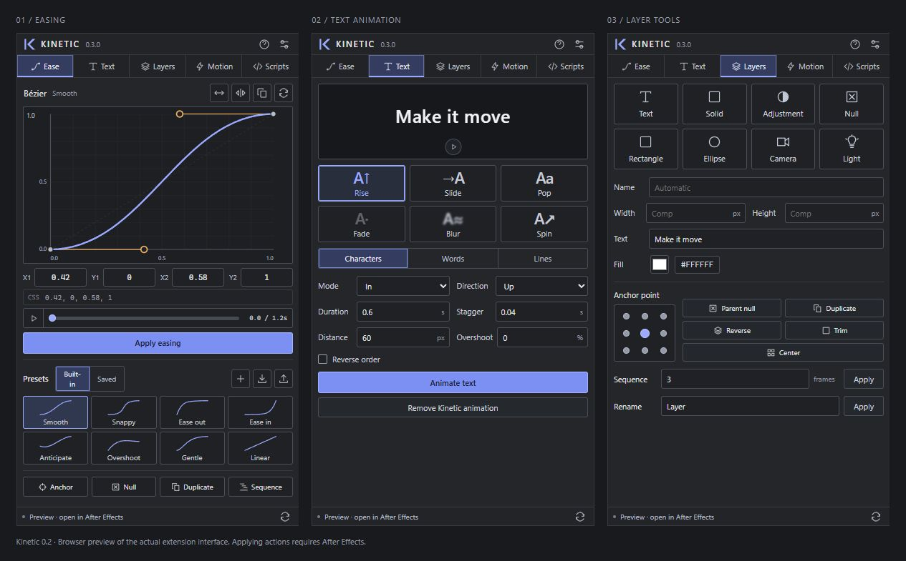

# Kinetic

### Motion tools, within reach.

Shape timing, animate type, and build your scene from one dockable **After Effects** panel. Kinetic brings a curve editor, text animation, quick layer creation, reusable motion, and custom scripts into the same workspace.

[Download v0.3.0](https://github.com/KNN-07/kinetic/releases/tag/v0.3.0) · [Installation](docs/INSTALL.md) · [Development](docs/DEVELOPMENT.md) · [Report an issue](https://github.com/KNN-07/kinetic/issues)

*Kinetic 0.3.0 — Ease, Text, and Layers in browser preview. Applying actions requires After Effects.*

## Five workspaces. One panel.

| | What you can do |
| --- | --- |
| **Ease** | Draw cubic Bézier curves, start from a preset, and apply native temporal easing. Save your own curves and share libraries as JSON. |
| **Text** | Animate characters, words, or lines with Rise, Slide, Pop, Fade, Blur, and Spin. Set stagger, direction, overshoot, and entrance/exit timing. |
| **Layers** | Create eight layer types. Move anchors, stagger layers, add a parent null, duplicate, reverse stack order, trim, center, and rename. |
| **Motion** | Add Wiggle, Loop, Ping-pong, or Overshoot to selected numeric properties. Adjust their parameters from the panel. |
| **Scripts** | Write custom ExtendScript, open and save JSX files, run code in AE, and inspect printed output and errors. Your draft stays saved locally. |

The built-in tools produce editable native keyframe easing, text animators, effect sliders, and expressions. Commands are grouped for Undo, and skipped selections explain why. Built-in tools preserve unrelated text animators and existing expressions from other tools. Custom scripts run with full AE scripting access; their behavior and undo support depend on the code you run.

## Get started

Download the **Kinetic v0.3.0 release ZIP** from [Releases](https://github.com/KNN-07/kinetic/releases), extract it completely, and close After Effects.

**Windows:** double-click `Install Windows.cmd` in the extracted folder.

**macOS:** open Terminal, type `bash `, drag `install-macos.command` into the window, and press Return.

Restart AE, then open **Window → Extensions → Kinetic** and dock it where you work. No Node.js installation is needed to use the panel.

This development build is unsigned. Both installers enable unsigned CEP extensions for the current user; see [installation details, upgrades, and removal](docs/INSTALL.md).

> **Early development:** Kinetic targets After Effects 2025 and 2026 through CEP 12. Native AE execution, rendering, and installation on either platform remain unverified. Try it in a disposable composition first; [compatibility and verification details](docs/DEVELOPMENT.md#compatibility-and-verification) explain the current boundaries.

## Make your first move

1. **Shape the timing.** Select two adjacent Opacity, Rotation, or Scale keyframes. In **Ease**, choose or adjust a curve, then apply it. For Position, use AE's **Separate Dimensions** first.
2. **Animate a title.** Select a text layer and place the playhead. In **Text**, choose a preset and unit, adjust duration and stagger, then apply. Both mode starts an entrance at the playhead and finishes an exit at the layer's out point.
3. **Build the scene.** In **Layers**, create text, solids, adjustment layers, nulls, rectangles, ellipses, cameras, or lights. Select existing layers to use the utilities below.
4. **Add motion.** Select a numeric property in the timeline. In **Motion**, choose a preset and apply it. Loop, Ping-pong, and Overshoot need at least two keyframes.
5. **Run your own tools.** In **Scripts**, write or open a `.jsx` file and click **Run script** (Ctrl/Cmd+Enter). Use `print(...)` for logs. Opening a file only loads it into the editor.

Hold **Shift while dragging a Bézier handle** to align it horizontally or vertically with its endpoint. Press or release Shift at any point during the drag. Shift+arrow keys still use larger nudge steps.

Anchor, center, and parent-null tools currently support static, unparented 2D layers. Spatial easing and Color are outside the current easing scope. The [tool behavior reference](docs/DEVELOPMENT.md#tool-behavior) covers these limits in detail.

## Explore and contribute

Open `index.html` for a browser preview, or follow the [development guide](docs/DEVELOPMENT.md) to build and test the source. The preview includes the curve editor, library, and script editing/import/export; AE actions and script execution require the installed panel.

Found an issue or have a workflow in mind? [Open an issue](https://github.com/KNN-07/kinetic/issues) with your AE version, operating system, and steps to reproduce. See the [changelog](CHANGELOG.md) for release changes.

Kinetic is original, independent software released under the [MIT license](LICENSE). It is not affiliated with Adobe or the makers of Motion, Flow, or Texto.
