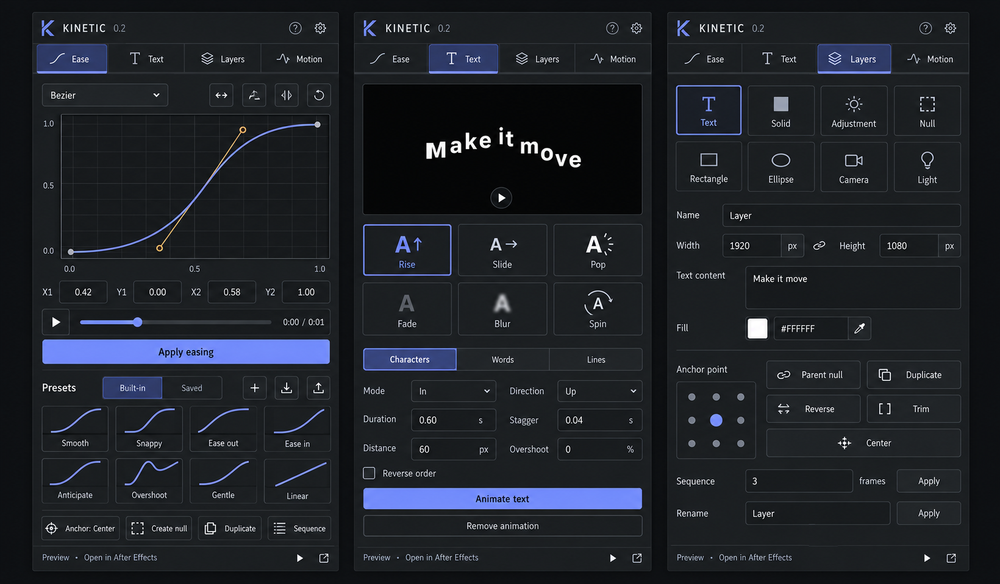

# UI design direction

The 0.2 interface is built from an AI-generated visual mockup, then implemented as real HTML/CSS/JavaScript controls. The mockup is a design reference, not a runtime screenshot. Visual verification of the redesigned interface is pending; `../screenshots.html` provides a three-panel preview for that review.

The compact layout takes workflow cues from [Flow's graph and library](https://aescripts.com/flow/) and [Motion's small utility panels](https://motion.mtmograph.com/m-screens/home). No competitor code, artwork, preset libraries, or branding is included.

Design decisions: 11–12px control labels, compact four-tab navigation, graph near the top, adjacent numeric controls and Apply action, four-column curve and layer grids, paired parameter fields, 3px corners, charcoal surfaces, violet selection, and amber graph handles. Large headings and promotional content are kept out of the extension.

Generated with the built-in image generation tool. The generation prompt is saved in `mockup-prompt.txt`.
